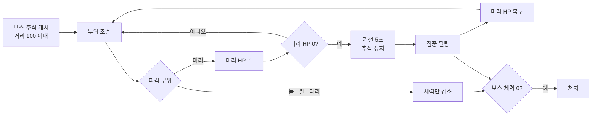

<div align="center">

# 부위 파괴 3인칭 슈터

**탄창은 7발, 적은 사방에서. 거인의 머리를 세 번 맞혀 쓰러뜨려라**

3인칭 사격 · 부위별 피격 판정 · 보스 기절 구간 딜링

[](https://unity.com)
[](https://learn.microsoft.com/dotnet/csharp/)


</div>

<!--
  ▼ 플레이 GIF를 docs/gif/play.gif 로 올린 뒤, 이 주석의 시작/끝 기호만 지우세요.
     보스 머리 3연타 → 기절 → 집중 딜링 구간이 가장 보여줄 만합니다.
<div align="center">
  
  <br><sub>조준 → 사격 → 재장전, 그리고 보스 기절 구간</sub>
</div>
-->

---

## 어떤 게임인가

3인칭 시점에서 몰려오는 적을 처리하고 **거대 보스**를 쓰러뜨리는 액션 슈터입니다.

탄창은 **7발**. 다 쓰면 재장전 모션이 끝날 때까지 무방비가 됩니다.
적은 플레이어를 추적하고, 피격당하면 화면이 붉게 번지며 넉백으로 자세가 흐트러집니다.

보스는 **부위별로 판정이 다릅니다.** 머리를 연속으로 맞히면 무너지고, 그때가 유일한 집중 공격 기회입니다.

> [!NOTE]
> **조작** — 이동 / 우클릭 줌 / 좌클릭 사격 / 재장전
> **탄창** — 7발, 재장전 중 공격 불가
> **보스** — 머리 3회 피격 시 5초간 기절

## 보스 공략 루프



## 주요 시스템

| 시스템 | 스크립트 | 설명 |
|---|---|---|
| **사격 · 재장전** | `MyPlayerController` | 레이캐스트 사격, 잔탄 관리, 재장전 코루틴, 머즐 플래시 |
| **부위 판정** | `BossHit` / `CheckBossHit` | 머리·몸·양팔·양다리를 enum으로 구분해 부위마다 다른 결과 |
| **보스 패턴** | `Boss` / `BossAttack` / `BossDie` | 거리 기반 추적, 주먹 공격, 기절·사망 상태 전이 |
| **적 추적** | `EnemyController` / `EnemyHit` | 거리 6 이내 접근 시 추적, 피격 시 반응 |
| **피격 연출** | `PlayerHitManager` / `PlayerHitImage` | 피격 이미지 오버레이 + 넉백 코루틴 |
| **조준 보조** | `ZoomCamera` / `HitCrosshairManager` | Cinemachine 줌 전환, 명중 시 크로스헤어 피드백 |

## 구현 포인트

### 보스를 **하나의 HP**가 아니라 **부위 상태 기계**로

보스에 체력 하나만 두면 "어디를 쏘든 똑같은" 싸움이 됩니다.
부위마다 콜라이더를 나누고 enum으로 태그해, **머리만 별도 카운터**를 깎게 했습니다.

```csharp
switch (BossH.bossDamageType)
{
    case BossHit.EnemyCollisionType.head:
        boss.bossHeadHp -= 1;      // 머리만 별도 카운터
        BossH.BossHIT();
        break;
    case BossHit.EnemyCollisionType.leftLeg:
    case BossHit.EnemyCollisionType.rightLeg:
        BossH.BossHIT();           // 체력만 감소
        break;
}
```

머리 카운터가 0이 되면 기절 코루틴이 돌고, **5초 뒤 카운터가 되돌아옵니다.**
덕분에 "머리를 노려 기회를 만들고 → 그 구간에 몰아친다"는 리듬이 생깁니다.

```csharp
public IEnumerator KnockDownBoss()
{
    boss.bossKnockDown = true;   // 추적 정지
    bossSad.SetActive(true);
    yield return new WaitForSeconds(5);
    boss.bossKnockDown = false;
    boss.bossHeadHp = 3;         // 다시 3회 노려야 한다
}
```

### 그 밖에

- **재장전 리스크** — 잔탄 관리와 재장전 코루틴을 분리해, 재장전 중에는 사격 입력을 무시
- **넉백** — 보스 주먹에 맞으면 충격 지점 기준 방향을 계산해 코루틴으로 밀려남
- **Starter Assets 기반 확장** — 기본 3인칭 컨트롤러 위에 사격·줌·피격을 얹어 1주 안에 완성

<details>
<summary><b>스크립트 구성</b></summary>

```
Assets/Scripts/
├─ MyPlayerController.cs   이동 · 카메라 · 사격 · 재장전 · 넉백 (12KB)
├─ MyPlayerInput.cs        Input System 바인딩
├─ Boss.cs                 보스 추적 · 상태
├─ BossHit.cs              부위별 피격 처리 · 기절 코루틴
├─ BossAttack.cs           주먹 공격 판정
├─ BossDie.cs              사망 처리
├─ EnemyController.cs      일반 적 추적
├─ EnemyHit.cs             적 피격 반응
├─ PlayerHitManager.cs     플레이어 피격 집계
├─ ZoomCamera.cs           조준 줌
└─ Ui.cs                   HP · 잔탄 표시
```

</details>

## 실행

```
Unity Hub → Add → Week3_Kyg_gamelab 폴더 선택 (Unity 6000.0.55f1)
Assets/Scenes/Lobby 열고 Play
```

<div align="right"><sub>3주차 · 2026.09.19 ~ 09.22</sub></div>
